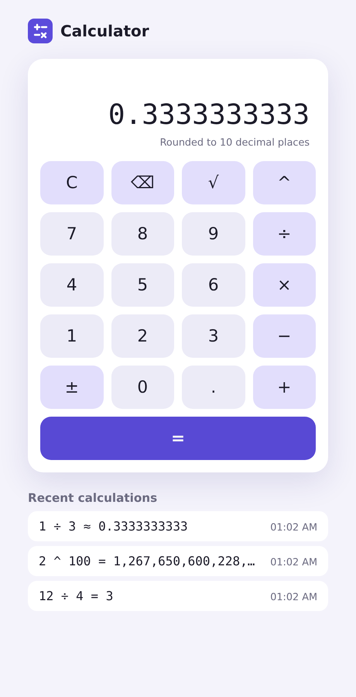

# Calculator

A full-stack calculator: a **React + TypeScript** frontend with a phone-style keypad, and a **Go** REST API that does the arithmetic **exactly**, on numbers of up to 1,000 digits.

- Operations: add, subtract, multiply, divide, power, square root
- `0.1 + 0.2` is exactly `0.3`; `99999999999999999999 × 99999999999999999999` keeps every digit
- Results are rounded to 10 decimal places, and the UI says when rounding happened
- Negative numbers anywhere: `±`, or `−` straight after another operator (`5 × − 3`, or `5*-3` on the keyboard)
- Validation on both sides, with identical error messages, kept in sync by a shared contract file
- Recent calculations saved in the browser



## Quick start

Requires Docker with Compose v2.

```sh
docker compose up --build
```

Open **http://localhost:3000**. The interactive API documentation is at **http://localhost:3000/api/docs**. To use another port, set `FRONTEND_PORT=8000` before the command.

## Development

**With Docker** (source folders mounted into the containers):

```sh
docker compose -f docker-compose.dev.yml up
```

Frontend changes reload in the browser instantly (Vite), and backend changes rebuild and restart the Go server automatically (Air).

**Without Docker** (needs Go 1.24+ and Node 22+), in two terminals from the repository root:

```sh
cd backend && go run ./cmd/server            # terminal 1: API on :8080
cd frontend && npm install && npm run dev    # terminal 2: UI on :3000, proxies /api to :8080
```

## Tests and coverage

| | Command | Result |
|---|---|---|
| Backend | `cd backend && go test -cover ./...` | `calculator` and `api` 100% of statements; in `cmd/server`, `run()` and `port()` are 100%, and only the `main()` wiring is untested (about 94% overall) |
| Backend without a local Go install (from the repo root) | `docker run --rm -v "$PWD":/repo -w /repo/backend golang:1.24-alpine go test -cover ./...` | same |
| Frontend | `cd frontend && npm test` | 182 tests |
| Frontend coverage | `cd frontend && npm run coverage` | 100% of statements, branches, functions and lines; HTML report in `frontend/coverage/` |
| Frontend lint and format | `cd frontend && npm run lint && npm run format:check` | ESLint (with React Hooks rules) and Prettier |
| Backend format and vet | `cd backend && gofmt -l . && go vet ./...` | `gofmt -l` lists unformatted files (none) |

**Contract tests.** [`contract/calculations.json`](contract/calculations.json) lists requests with the exact status and response the API must return. The Go tests send every request and compare the response exactly. The frontend tests check that its validation returns the same error, word for word, and that its API client reads every response. If either side changes a rule or a message without the other, a test fails. (Both test suites read the file from the repository root, so run them from a full checkout.)

## API

**Interactive documentation:** [`/api/docs`](http://localhost:3000/api/docs) is a Swagger UI page with every endpoint, input, output and error code, with examples and a "Try it out" button that calls the real API. The page loads Swagger UI from a CDN, so it needs internet access. The OpenAPI 3.1 description behind it is at `/api/openapi.json`, and a test checks it against the code (operations, number format, error codes and statuses), so it can't drift.

All numbers travel as **JSON strings**, so no precision is lost on either side.

### `POST /api/v1/calculate`

```sh
curl -X POST http://localhost:3000/api/v1/calculate \
  -H 'Content-Type: application/json' \
  -d '{"number1": "1", "operation": "divide", "number2": "3"}'
```

```json
{ "result": "0.3333333333", "rounded": true }
```

| Field | Notes |
|---|---|
| `number1` | Required. Plain decimal: optional `-`, digits, optional `.digits`. No `+`, `1e5`, `.5`, `5.`, commas or spaces. At most 1,000 digits |
| `operation` | `add`, `subtract`, `multiply`, `divide`, `power` or `sqrt` |
| `number2` | Required, except for `sqrt` (where it is ignored). Same format as `number1` |
| → `result` | Plain decimal string, at most 10 decimal places, trailing zeros removed |
| → `rounded` | `true` when the exact answer had more than 10 decimal places |

Square root sends only one number:

```sh
curl -X POST http://localhost:3000/api/v1/calculate -d '{"number1": "2", "operation": "sqrt"}'
# {"result":"1.4142135624","rounded":true}
```

### Errors

Every error has the same shape. `field` names the input at fault, when there is one:

```json
{ "code": "DIVISION_BY_ZERO", "message": "Division by zero is not permitted.", "field": "number2" }
```

| Status | `code` | When |
|---|---|---|
| 400 | `INVALID_NUMBER` | Missing number, or not a plain decimal |
| 400 | `NUMBER_TOO_LONG` | More than 1,000 digits |
| 400 | `UNKNOWN_OPERATION` | Operation not in the list |
| 400 | `INVALID_REQUEST` | Malformed JSON, a number sent as a JSON number, or extra data after the object |
| 404 | `NOT_FOUND` | Unknown path |
| 405 | `METHOD_NOT_ALLOWED` | Wrong method for the path (the `Allow` header lists the right one) |
| 413 | `REQUEST_TOO_LARGE` | Body over 16 KB |
| 422 | `DIVISION_BY_ZERO` | `x ÷ 0`, or `0 ^ -n` |
| 422 | `NEGATIVE_SQUARE_ROOT` | `√` of a negative number |
| 422 | `NON_INTEGER_EXPONENT` | `2 ^ 0.5` |
| 422 | `RESULT_TOO_LARGE` | A power whose result would exceed about 10,000 digits |
| 500 | `INTERNAL_ERROR` | Unexpected failure (details are logged, never returned) |

Rule of thumb: **400** means the request breaks the API's rules; **422** means the request is valid but the maths has no answer.

### `GET /api/health`

Returns `{"status": "ok"}` (also answers `HEAD`). Unversioned, because it describes the server rather than the calculator contract. Docker Compose uses it as the backend's health check.

### `GET /api/docs` and `GET /api/openapi.json`

The interactive documentation and its OpenAPI 3.1 description (see above).

## Architecture

```
Browser ──► nginx (frontend container; :3000 on your machine → :8080 inside)
              ├─ /        → built React app
              └─ /api/... → Go backend (backend container, :8080, not published)
```

```
backend/
  cmd/server/main.go          startup: port, timeouts, graceful shutdown (run() is tested)
  internal/calculator/        all maths and validation rules; knows nothing about HTTP
    calculator.go             entry point: Calculate and the list of operations
    parse.go                  input rules
    power.go, sqrt.go         the two non-trivial operations
    round.go                  rounding to 10 decimal places
    errors.go                 error codes and every user-facing message
  internal/api/               HTTP: routing, JSON, body limit, error code → status, request logging
    openapi.json, docs.go     OpenAPI description (embedded in the binary) and the Swagger UI page
contract/calculations.json    shared request/response cases, checked by both test suites
frontend/src/
  lib/keypad.ts               keypad rules as a pure reducer (state, action) → state
  lib/calculation.ts          validate, then send; build the history entry
  lib/validation.ts           TypeScript copy of the backend's input rules
  lib/api.ts                  the one place that calls the backend
  lib/history.ts              localStorage history
  lib/format.ts               display-only number formatting
  lib/operations.ts           operation list, symbols and names
  components/                 App, Header, Calculator, Display, Keypad, HistoryList
  contract.test.ts            frontend side of the shared contract
```

## Design decisions

The full reasoning, alternatives, tradeoffs and assumptions for each decision are in **[DECISIONS.md](DECISIONS.md)**. In short:

- **Structured input, one operation per request.** No expression parsing; chained input is sent as separate requests.
- **A phone-style keypad** with keyboard support; negative numbers via `±`, or `−` straight after another operator.
- **Exact arithmetic** with Go's `math/big` instead of `float64`, so no precision loss. Fractional exponents aren't supported.
- **Numbers as JSON strings**, since JavaScript numbers lose digits past about 15–17.
- **Limits** on input digits, body size and power result size, to protect the server.
- **Rounding to 10 decimal places** with a `rounded` flag. Chaining uses the rounded value (`1 ÷ 3 × 3 = 0.9999999999`).
- **Validation on both sides**, with the backend's wording copied word for word and checked by the shared contract file.
- **A same-origin proxy** (nginx or Vite) instead of CORS; one versioned endpoint.
- **History in localStorage**; a **one-line display** with separators on screen only.
- **Interactive API docs** from an OpenAPI description that a test keeps in sync with the code.

## Known limitations and possible next steps

- No rate limiting. It's out of scope for this exercise; it would sit in nginx, or in a gateway if more services are added.
- The validation rules are still written twice (Go and TypeScript). The contract tests catch any drift, but a change needs editing both sides.
- No browser end-to-end tests: the frontend tests run against a fake `fetch`, and the shared contract file is what ties them to the real API.

## AI usage

This project was built with an AI assistant (Claude Code), with the design worked out step by step before code was written. [PROMPTS.md](PROMPTS.md) gathers those decisions into paste-ready prompts that rebuild the repository.
